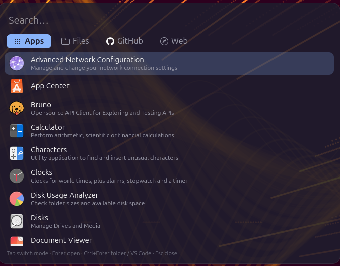

# hopla

A Spotlight-style launcher for GNOME on Wayland. Press **Super+Space**, type, and open apps,
files, GitHub repositories or web searches from a single floating box.



## Why

On a GNOME desktop, the small things a developer does all day are spread across different
places:

- **Apps** are in the Activities overview, which takes over the whole screen.
- **Files** mean opening Nautilus and clicking through folders, or remembering paths in a
  terminal.
- **GitHub repos** mean opening the browser, going to github.com and searching there. To
  open a repo you have already cloned, you have to find its folder and open it in your editor.
- **Web searches** mean opening the browser, opening a tab and picking the site first.

Each one is a context switch. Together they add up to a lot of clicks and lost focus.

hopla puts all four in **one box behind one shortcut**:

- **One shortcut for everything.** Super+Space opens a small floating window over what you
  are doing, and Esc (or clicking away) brings you straight back.
- **Keyboard only.** Type, use Tab to change category, press Enter. You don't need the mouse,
  and the text you typed is kept when you switch tabs.
- **Your GitHub work, one keystroke away.** Your repos and your organizations' repos are listed
  and cached locally, so they show up as you type. Enter opens the repo on GitHub;
  Ctrl+Enter opens your local clone in VS Code. Pull requests, issues and notifications are
  one click away too.
- **Fast file search.** It uses `fd` across your home folder, skips `node_modules` and `.git`,
  and shows recently used files before you type anything.
- **Site-aware web search.** Type `youtube lofi` to search YouTube directly, or paste a URL
  to open it.
- **Light and native.** It is a single Python script on GTK 4: no Electron, no background
  daemon. It only runs while it is open.

## Features

The launcher has four tabs. The text you typed is kept when you switch between them.

| Tab | What it searches | Enter | Ctrl+Enter |
| --- | --- | --- | --- |
| **Apps** | Installed applications (name, keywords and executable, fuzzy matched) | Launch the app | — |
| **Files** | Your home folder with `fd`. Excludes `node_modules` and `.git`. When the box is empty it shows your standard folders and recently used files | Open with the default app | Show the file in Nautilus |
| **GitHub** | Your repos and your organizations' repos (cached, refreshed in the background with `gh`), plus public repos from 3 characters on | Open in the browser | Open the local clone in VS Code (if it is in `~/Work` or `~/Projects`) |
| **Web** | Google, YouTube and GitHub searches; quick links to Gmail, Google, YouTube, GitHub, Amazon and Spotify; anything that looks like a URL | Open in the default browser | — |

Smaller details:

- In the Web tab you can search a single site by starting with its name, for example
  `youtube lofi` or `open spotify`.
- With an empty query, the GitHub tab shows shortcuts to your pull requests, issues and
  notifications.
- The interface follows the system language (English, Spanish or Portuguese) and falls back
  to English.
- Only one window runs at a time. Running the command again while it is open closes it, so
  the same shortcut opens and closes it.
- The window closes when it loses focus (for example with Alt+Tab) or when you click outside it.

## Keyboard shortcuts

| Key | Action |
| --- | --- |
| `Super+Space` | Open / close the launcher (set up by `install.sh`) |
| `Tab` / `Shift+Tab` | Next / previous tab |
| `Ctrl+1` … `Ctrl+4` | Jump to Apps, Files, GitHub or Web |
| `↑` / `↓` | Move the selection |
| `Enter` | Open the selected result |
| `Ctrl+Enter` | Alternative action (see the table above) |
| `Esc` | Close |

## Built with

- **Python 3**: a single script, no third-party Python packages.
- **GTK 4** through **PyGObject** (`gi`): the UI, styled with GTK CSS.
- **GLib / Gio**: async subprocesses, app discovery (`Gio.AppInfo`), opening files and URLs.
- **fd**: fast file search.
- **GitHub CLI (`gh`)**: lists your repos (`gh api`) and searches public ones (`gh search repos`).
- **Bash + `gsettings`**: the installer and the GNOME custom keyboard shortcut.

## Requirements

Install these first:

| Requirement | Needed for | Ubuntu / Debian package |
| --- | --- | --- |
| GNOME desktop (Wayland or X11) | Running the launcher and the Super+Space shortcut | — |
| Python 3.9 or newer | Running the script | `python3` |
| PyGObject | Python bindings for GTK | `python3-gi` |
| GTK 4.12 or newer | The window and widgets | `gir1.2-gtk-4.0` |
| `fd` *(optional)* | The **Files** tab | `fd-find` |
| GitHub CLI *(optional)* | The **GitHub** tab; log in with `gh auth login` | `gh` |
| Nautilus *(optional)* | Ctrl+Enter on a file | `nautilus` |
| VS Code *(optional)* | Ctrl+Enter on a cloned repo; the `code` command must be in your PATH | `code` |

On Ubuntu / Debian:

```bash
sudo apt install python3 python3-gi gir1.2-gtk-4.0 fd-find gh
gh auth login
```

## Installation

```bash
git clone git@github.com:pedroj4567/hopla.git
cd hopla
./install.sh
```

What `install.sh` does:

1. Runs a **doctor** that checks every requirement and prints what is missing, with the exact
   command to install it (for `apt`, `dnf` or `pacman`). It stops if a required package is
   missing; optional ones only produce a warning.
2. Symlinks `buscador` to `~/.local/bin/buscador` and the `icons/` folder to
   `~/.local/share/buscador/icons`. Because these are links, `git pull` updates the
   launcher without reinstalling.
3. Adds a GNOME custom keyboard shortcut, **Super+Space**, that runs `~/.local/bin/buscador`.
   If you already have a shortcut called `buscador`, or one for Ulauncher, it is left unchanged.

### Doctor only

To check the requirements without installing anything:

```bash
./install.sh --doctor
```

```text
Checking requirements…
Required:
  ✓ GNOME (gsettings, keyboard shortcuts)
  ✓ Python 3.12.3
  ✓ PyGObject
  ✓ GTK 4.14
Optional:
  ! fd not found: the Files tab won't work
  ! GitHub CLI not found: the GitHub tab won't work
  ✓ Nautilus (Ctrl+Enter on files)
  ✓ VS Code (Ctrl+Enter on cloned repos)
  ✓ /home/you/.local/bin is in PATH

Missing (optional):
  sudo apt install fd-find gh
Also:
  - After installing gh, log in: gh auth login
```

## Usage

- Press **Super+Space**.
- Or run it from a terminal (make sure `~/.local/bin` is in your `PATH`):

  ```bash
  buscador
  ```

- To change the shortcut, go to **Settings → Keyboard → View and Customize Shortcuts → Custom
  Shortcuts → Buscador**.

## Uninstall

```bash
rm ~/.local/bin/buscador ~/.local/share/buscador/icons
rm -rf ~/.cache/buscador
```

Then delete the **Buscador** shortcut in **Settings → Keyboard → Custom Shortcuts**.

## License

[MIT](LICENSE). The brand logos in `icons/` come from [Simple Icons](https://simpleicons.org)
(CC0) and are trademarks of their respective owners.
